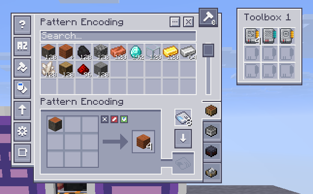
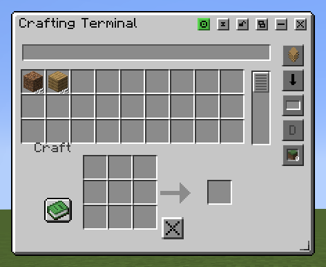
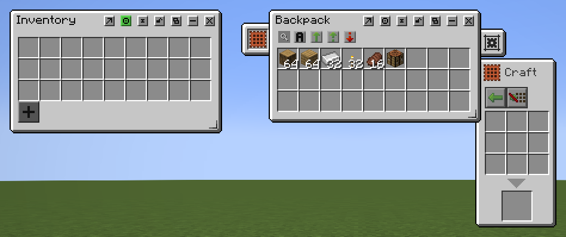
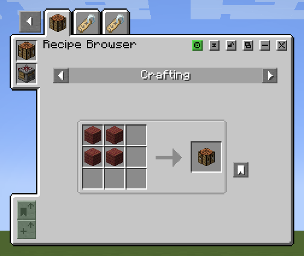

<!--
Suggested short description:
Adds optional mod integrations to Salt's Inventory Update, including AE2,
Tom's Storage, Sophisticated storage and recipe browsers.

Publishing images:
The four cropped in-game screenshots below are included in modrinth-images
next to this file. They were freshly captured on 2026-10-20.
Upload them through Modrinth's description editor, replace the relative image
paths with the resulting hosted URLs, and remove this comment before publishing.
-->

# Salt's Inventory Compatibility

Salt's Inventory Compatibility brings supported modded inventories and recipe browsers into the movable window system provided by [Salt's Inventory Update](https://modrinth.com/mod/salts-inventory-update). Use storage terminals, backpacks and other supported interfaces alongside your player inventory and other open containers.

**Requires Salt's Inventory Update.** Install the Compatibility JAR alongside the Core JAR for the same Minecraft version and loader. Compatibility **0.1.2** requires Core **0.1.5** on every supported target; the two mods have independent version numbers. Core provides the inventory framework and works on its own. This extra JAR provides the integrations listed below. The optional Controlify companion **0.1.1** uses the same Core release.

Install third-party mods separately, together with their own dependencies. You only need the integrations for the mods you use; the extension does not require every supported mod to be installed.

## Applied Energistics 2

Open supported AE2 terminals, pattern interfaces, crafting status screens and machine interfaces as desktop windows. Keep native settings and navigation, follow crafting CPU updates, and use separate toolbox companion windows where available.

AE2 interfaces retain the artwork and features of the installed AE2 release. Older releases keep their own design rather than being made to look like newer versions.

*AE2 pattern encoding terminal with a separate toolbox companion, shown on Minecraft 26.3 NeoForge.*

The reviewed AE2 adapters support:

- **Minecraft 1.20.1, Fabric and Forge:** AE2 15.4.11.
- **Minecraft 1.21.1, NeoForge:** AE2 19.2.18.
- **Minecraft 26.1.2, NeoForge:** AE2 26.1.13-beta.
- **Minecraft 26.2, NeoForge:** AE2 26.2.1-alpha.
- **Minecraft 26.3, NeoForge:** AE2 26.3.1-alpha.

The [reviewed upstream AE2 releases](https://appliedenergistics.org/download) do not include modern Fabric builds or a 1.21.11 build for either loader. Those combinations have no eligible AE2 integration. Check the matching release notes before using a different upstream AE2 version.

## Tom's Simple Storage

Adds desktop support for storage and crafting terminals, inventory configuration, filters, links, level emitters and filing cabinets. Supported terminals keep storage search, item access and crafting within the window system.

Available interfaces follow the installed release. Minecraft 1.20.1 uses Tom's native 1.7.x artwork and seven menus, including its nine-slot filtered connector; that release has no filing cabinet or newer inventory-configurator item.

*Tom's Simple Storage crafting terminal, shown on Minecraft 1.21.1 Fabric.*

## Sophisticated Backpacks and Storage

Use supported Sophisticated Backpacks and Sophisticated Storage interfaces as desktop windows, including their inventory controls, upgrade panels and settings navigation. This integration uses Sophisticated Core and supports the available Forge and NeoForge editions, plus the maintained Fabric ports on Minecraft 1.20.1 and 1.21.1.

*Sophisticated Backpack with its crafting upgrade panel and the separate player inventory, shown on Minecraft 1.21.1 NeoForge.*

For Fabric 1.20.1 and 1.21.1, install the matching unofficial Fabric ports of Sophisticated Core, Backpacks and Storage. Newer Fabric targets have no published release of these ports in the reviewed upstream matrix.

## JEI, REI and EMI

Connect supported versions of Just Enough Items, Roughly Enough Items and EMI to Salt's recipe browser window. Search items, view recipes and uses, save bookmarks and request ingredient transfers into compatible open crafting windows.

Open the recipe browser with its configurable keybinding, **H** by default. Available categories, ingredients and transfer behavior depend on the installed provider and the destination inventory.

*A crafting recipe in the desktop recipe browser using JEI, shown on Minecraft 1.21.1 Fabric.*

JEI and REI integrations are included across the supported build matrix where compatible provider releases are available. EMI integration is provided for Minecraft 1.20.1 on Fabric and Forge, and Minecraft 1.21.1 on Fabric and NeoForge.

On Fabric, the extension also adds **Mod Menu** access to Salt's configuration screen when Mod Menu is installed.

## Installation

1. Install the Minecraft version and mod loader required by your chosen release.
2. Install the matching **Salt's Inventory Update** Core JAR and its required dependencies, including Fabric API on Fabric.
3. Install **Salt's Inventory Compatibility** for the same Minecraft version and loader, using the Core version required by the extension release.
4. Install the supported third-party mods you want to use, together with their own required dependencies.

For example, Minecraft 1.21.1 Fabric with Compatibility 0.1.2 needs Core 0.1.5: `salts_inventory_update-1.21.1-Fabric-0.1.5.jar` and `salts_inventory_compat-1.21.1-Fabric-0.1.2.jar`.

For supported container integrations in multiplayer, install matching Core and Compatibility versions on both the client and server. Recipe-browser mods and Mod Menu belong on the client; follow each third-party mod's own installation requirements for its other dependencies.

## Minecraft and Loader Availability

| Minecraft | Extension builds |
| --- | --- |
| 1.20.1 | Fabric, Forge |
| 1.21.1 | Fabric, NeoForge |
| 1.21.11 | Fabric, NeoForge |
| 26.1.2 | Fabric, NeoForge |
| 26.2 | Fabric, NeoForge |
| 26.3 | Fabric, NeoForge |

An extension build does not mean every integration is available on that target. Support also depends on the third-party mod's loader, version and interface compatibility. Unsupported screens retain their ordinary interface where no eligible desktop integration is available.

## Support

If an integration behaves incorrectly, report the Minecraft version, loader, Core and Compatibility versions, affected third-party mod version, and steps to reproduce it. Include a screenshot for interface problems and a log for crashes or loading errors.

- [Report an issue](https://github.com/Salt-and-Fries/Salt-s-Inventory-Update/issues)
- [Core mod](https://modrinth.com/mod/salts-inventory-update)
- [Source code](https://github.com/Salt-and-Fries/Salt-s-Inventory-Update)
- [Public API documentation](https://salt-and-fries.github.io/Salt-s-Inventory-Update/)

### Raised

With Raised installed, detached hotbar and offhand interactions follow your HUD position, including custom horizontal/vertical offsets and live changes. Requires Raised 6.0.2 or later with the supported API. Available for every supported Minecraft/loader pair; Raised remains optional.
