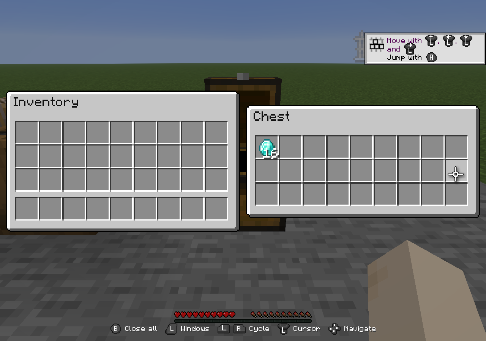
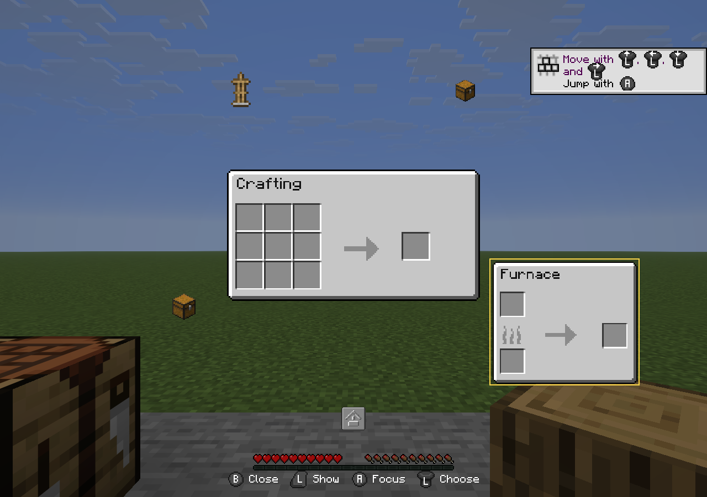
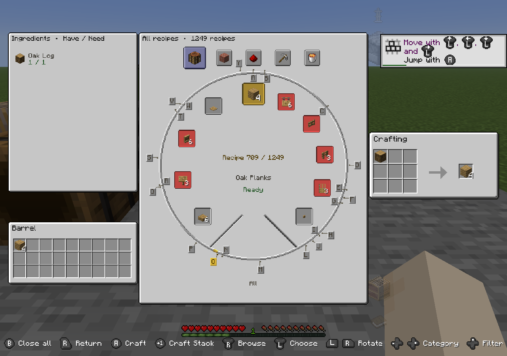
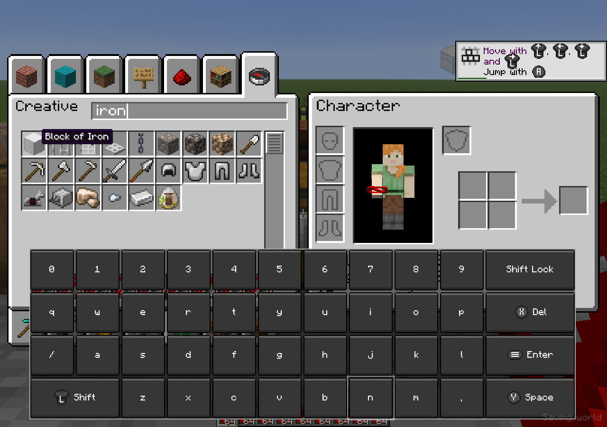
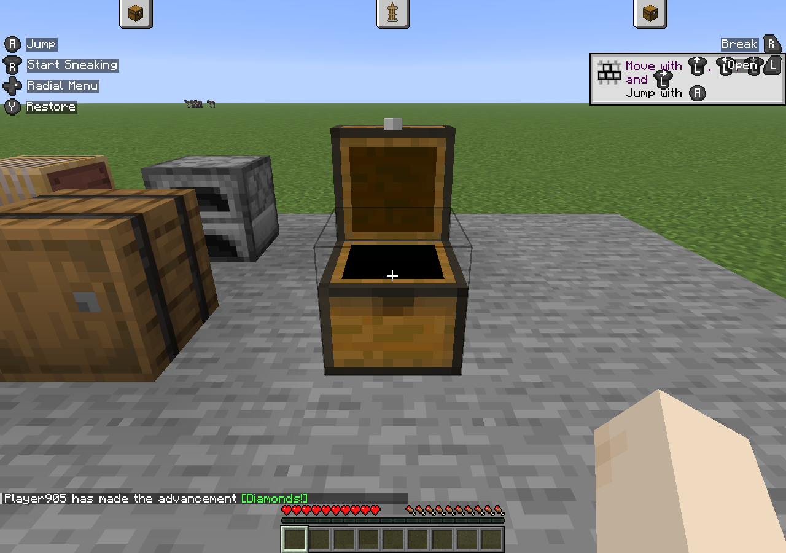
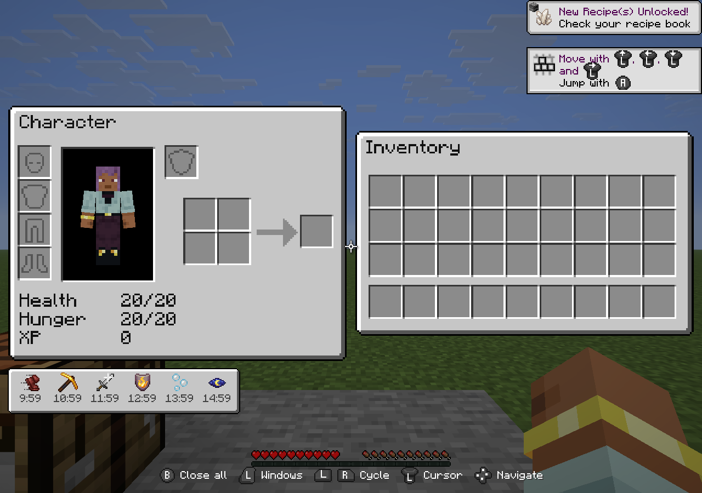

<!-- Publishing note: The six screenshots are bundled in docs/modrinth/images/. Upload them in the Modrinth description editor and replace the relative image paths with the resulting image URLs before publishing. -->

# Salt's Inventory Controlify

Salt's Inventory Controlify adds a controller interface to Salt's Inventory Update. Manage open containers, move items, browse recipes, craft, and search inventories using Controlify's controller input and on-screen keyboard.

This is an add-on for **[Salt's Inventory Update Core](https://modrinth.com/mod/salts-inventory-update)** and **[Controlify](https://modrinth.com/mod/controlify)**. The separate Salt's Inventory Compatibility extension is optional and provides integrations for supported third-party mods.

Companion **0.1.1** requires **Core 0.1.5** on every supported target. The optional Compatibility extension **0.1.2** uses the same Core release. Choose matching Minecraft versions and loaders for all installed files. Core's regular-window tutorial stays closed automatically while this companion is installed; manual help remains available.

## Inventory windows

Two windows are displayed side by side so you can work with your inventory and a container, or move items between two open containers. The focused window stays on the left, and the selected window appears on the right.

Use the D-pad to move between slots and controls. Navigation follows the logical layout of supported menus, including workstations with staggered slots such as brewing stands. In scrollable grids, moving past the last visible row scrolls the list before moving into a separate group of slots. The right stick provides smooth scrolling under the cursor.

LB and RB cycle through open windows. Smaller item previews above and below the selected window show nearby choices. The cursor and carried item scale with the displayed window.

## Window selection wheel

Hold LT to display the open-window wheel. Use the left stick to highlight a window, then release LT to display it on the right. Press A to move the highlighted window into focus on the left.

Inactive windows are represented by item or block icons. The focused window and highlighted choice show their full interfaces. The center window stays inside the surrounding ring of icons.

Pressing B in this wheel closes the highlighted window if it can be closed. Pressing B in the normal side-by-side view closes the workspace. Neither action requires holding B.

## Crafting and cooking wheels

Hold RT over a supported crafting or cooking window to open its recipe wheel. This is available for crafting tables, Character's 2x2 crafting grid, furnaces, blast furnaces, and smokers.

The right stick browses the recipe catalog continuously. The left stick selects a visible recipe, and holding LB or RB rotates the selection more slowly for fine adjustment. Alphabet markers help locate recipes by name.

- Change categories with D-pad Left and Right.
- Cycle **All**, **Contains Parts**, and **Craftable** with D-pad Up. Your filter is remembered when the wheel closes.
- Ingredient availability includes your inventory and eligible open containers.
- The materials panel shows what you have and what the recipe needs.
- The actual crafting or cooking window remains visible on the right, and the destination window appears below the materials panel.
- Available ingredients are placed into the native input slots while browsing. Missing ingredients appear as translucent red previews. Unused preview ingredients return to their original containers when you change recipes or leave the wheel.

In a crafting wheel, A crafts one recipe operation into the opposite displayed inventory. Y performs **Craft Stack**, crafting complete batches up to the result's normal stack limit, or stopping earlier when supplies or destination space run out. Crafted items sent to player inventory fill the hotbar first, then the main inventory.

Cooking wheels prepare the native inputs and fuel. Furnaces continue to process items at their normal speed. Quick-moving fuel into a paired furnace uses its fuel slot.

The selected recipe and wheel position remain stable while crafting updates ingredient counts and availability.

## Creative inventory and text entry

Creative inventory supports D-pad navigation through its item grid and tabs. A adds one catalog item directly to the hotbar, and Y adds a full stack, using compatible stacks or empty slots. The creative tab wheel provides another way to choose a category.

Selecting a catalog item while carrying a stack clears the carried stack without adding another item. While browsing a regular creative tab, Quick Move deletes only the hovered hotbar stack. Other windows and the creative Inventory tab retain their normal transfer behavior.

With the creative Search tab open, press X while hovering over the Creative window to focus search and open Controlify's on-screen keyboard. Selecting the search field with A opens the same keyboard.

Supported modded text fields also open the keyboard when selected. While the keyboard is open, controller actions, clicks, and scrolling go to it. Closing it restores inventory controls after the opening and closing inputs are released.

## Tuck windows away

Choose the tuck option in the window wheel to return to gameplay while keeping your windows open. Small item tabs remain at the top of the screen to show which windows are retained.

Press the inventory button to restore the same workspace. Tucking preserves open container sessions and any item on the cursor. Closing the whole workspace returns carried items and Character crafting ingredients to player inventory, dropping overflow using Minecraft's normal rules.

## Character and status effects

The Character window contains equipment slots, the player preview, health, hunger, XP, and 2x2 crafting. Active status effects appear in a compact tray below it, with dark-grey countdown text and no drop shadow. The tray keeps Character at its normal size and stays within the screen bounds. Hover an effect to see its name, level, and remaining time.

## Controls and preferences

The on-screen action guide changes with the active window and menu. It uses short labels and controller icons in rows along the bottom of the screen.

These are the default Xbox-style button names. Your on-screen guide reflects the configured bindings.

| Input | Context | Action |
| --- | --- | --- |
| Left stick | Inventory windows | Move the cursor |
| D-pad | Inventory windows | Navigate slots and controls |
| Right stick | Scrollable content | Scroll the list under the cursor |
| LB / RB | Side-by-side view | Cycle the selected window |
| LT | Side-by-side view | Open the window selection wheel |
| A | Window selection wheel | Focus the highlighted window |
| B | Window selection wheel | Close the highlighted closable window |
| B | Side-by-side view | Close the workspace |
| RT | Supported window under the cursor | Open its crafting, cooking, or creative tab wheel |
| A / Y | Crafting wheel | Craft / Craft Stack |
| X | Creative Search tab | Focus search and open the keyboard |

Under **Controls > Inventory controls**, the window wheel and quick-action wheel can each use **Hold** or **Toggle** mode. Hold is the default. Toggle mode keeps a wheel open until its trigger is pressed again.

**Inventory sounds are off by default.** Optional presets and volume controls are available under **Options > Music & Sounds > Controller sounds**. Window animations can also be disabled in the companion's configuration.

## Mod compatibility

Install the matching **Salt's Inventory Compatibility** extension to use its supported integrations, including JEI, REI, EMI, Tom's Simple Storage, Applied Energistics 2, and Sophisticated Storage or Backpacks where available for your Minecraft version and loader.

Supported windows can expose tabs, buttons, scrollable lists, text fields, and virtual or ghost slots to the controller interface through Salt's desktop API. Item movement and special slot behavior remain controlled by the original mod. An unsupported screen needs a Salt integration before it can participate in this workspace.

The Compatibility extension is optional for vanilla inventories and workstations. It does not replace Core, Controlify, or the Controlify companion.

## Installation

Install matching files for your Minecraft version and mod loader:

1. **Salt's Inventory Update Core**.
2. **Controlify**, or **Controlify: Forgified** for Minecraft 1.20.1 Forge.
3. **YetAnotherConfigLib (YACL)** for that loader and Controlify version.
4. **Salt's Inventory Controlify**.
5. **Fabric API** when using Fabric.

Add **Salt's Inventory Compatibility** if you need its supported mod integrations, along with the mods you want to use.

Use the dependency versions specified for the selected download. Minecraft 1.20.1 Fabric uses **Controlify 2.0.4**. The 1.20.1 Forge build uses **Controlify: Forgified** and also requires **Mixin Args**.

The Controlify companion is installed on the client. Multiplayer requires the matching **Core** version on both the client and server. Install updated matching Core and companion files together.

## Available versions

| Minecraft | Loaders |
| --- | --- |
| 1.20.1 | Fabric, Forge |
| 1.21.1 | Fabric, NeoForge |
| 1.21.11 | Fabric, NeoForge |
| 26.1.2 | Fabric, NeoForge |
| 26.2 | Fabric, NeoForge |
| 26.3 | Fabric, NeoForge |

Each companion file is specific to its Minecraft version and loader. Third-party integrations depend on which mods are available for that target. Screenshots on this page show Minecraft 26.3.

## Support

[Report issues on GitHub](https://github.com/Salt-and-Fries/Salt-s-Inventory-Update/issues). Include your Minecraft version, loader, Core version, Controlify version, companion version, and the steps needed to reproduce the problem.
