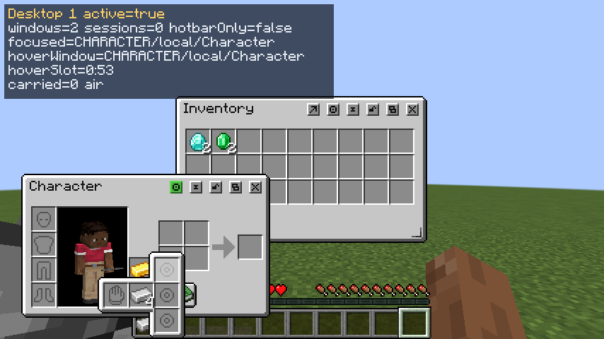
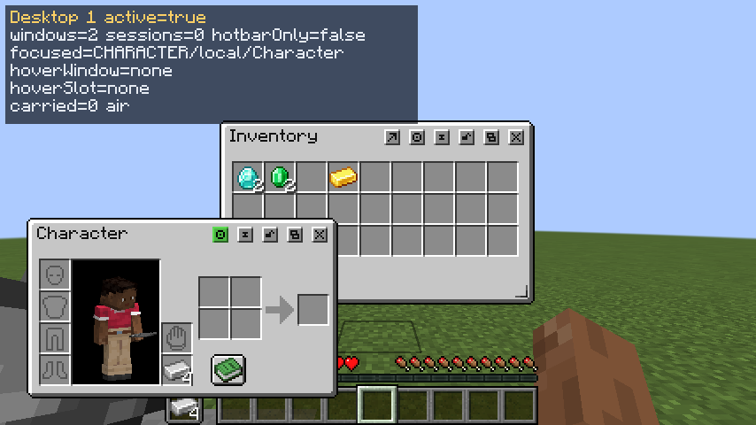

# Trinkets 1.20.1 Fabric: focused port validation

Executed on 2026-10-22 with Java 17, Fabric Loader 0.16.10, the project's 1.20.1 Fabric API,
Trinkets 3.7.2, Core 0.1.5 and Compatibility 0.1.2. Native test equipment comes from the
separate opt-in QA fixture; it is excluded from both production JARs.

## Checks performed

- Both Fabric modules compile and assemble into remapped production JARs.
- The shared 1.20.1 Core and Compatibility sources compile for Forge. Trinkets native
  sources remain excluded from Forge; no Forge release JAR was replaced.
- A disposable integrated-server world starts with Trinkets. Character opens beside
  Inventory and retains its native crafting slots, player preview and real offhand.
- The head/hat popup renders its complete frame and icons above the player preview.
- Two diamonds equip through a real native hat slot, trigger the native `onEquip` and
  tick callbacks, unequip through the same slot and trigger `onUnequip`. Returning the
  stack to Inventory preserves its count.
- Four iron ingots are rejected by the glove slot's native tag validator. The same
  stack can be placed in Character's real offhand and appears in the HUD offhand.
  HUD pickup clears Character's view; Character placement restores both views with
  exactly four ingots and an empty shared cursor.
- A gold fixture item equips in the glove slot. Its native removal restriction rejects
  an attempted pickup, preserving the gold item and empty cursor.
- Offhand/ring expansion renders the complete active popup above the neighboring gold
  slot. A click inside the upper ring slot targets that ring, with the active popup
  retained. The screenshot records the specific overlap from the earlier visual bug.
- `/trinketsqaclient equipment 9` sends the authenticated desktop equipment transfer;
  the server reports `moved=true` and equips the two diamonds through native rules.
- Three consecutive native menu rebuilds preserve slot indices, stable identities,
  synchronized tracking-list lengths, equipped items and both expanded storage slots.
- A native modifier grows hand/ring from three to four slots. Client and server agree
  on all **62** slot identities and contents afterward, including both expanded slots;
  both cursors are empty. The fixture asserts tracker alignment and duplicate identities.
- A separate client profile starts Core + Compatibility with Trinkets absent. Native
  adapter classes and the conditional rebuild mixin do not cause a startup failure.
- The source and production-JAR boundary scanner passes: native Trinkets code is in
  Compatibility, its Core references use public API, and Core has no native dependency.
- Staging replaces only the two 1.20.1 Fabric files and their aggregate ZIP entries.
  The other **34** distribution JARs retain their hashes. Distribution checksums refresh.

The initial fixture launch exposed a test-resource difference: legacy item tags use
`tags/items`, while 1.21.1 uses `tags/item`. The 1.20.1 fixture source now uses the correct
paths. The active disposable world received the same corrected tags through a test-only
datapack and `/reload` before equip/validation checks. This was a fixture correction.

## Evidence

- Fixture: `functional-tests/trinkets-1.20.1-fabric/`.
- Launcher: `functional-tests/trinkets120-qa.init.gradle`.
- Compile: `build/trinkets120-compile.log`.
- Gameplay: `build/trinkets120-gameplay-r2.log`.
- Callbacks and snapshots: `build/trinkets120-qa/`.
- Popup selection: `build/trinkets120-popup-state.json`.
- Absent-mod startup: `build/trinkets120-absent-startup.log`.
- Production build: `build/trinkets120-release-build.log`.
- Boundaries: `build/trinkets120-boundaries.log`.
- Staged paths and hashes: `build/trinkets120-release-artifacts.json`.

## Coverage limits

These are focused checks, not a complete functional or gameplay suite. Dedicated/remote
multiplayer, production-launcher gameplay, every accessory content mod, creative inventory,
every GUI scale, extreme datapack slot counts and combined Controlify/Spatial GUI/Mouse
Tweaks behavior were not tested in this port. The absent-mod check covers client startup,
not a second full gameplay session. Only Trinkets 3.7.2 is enabled on 1.20.1 Fabric.
