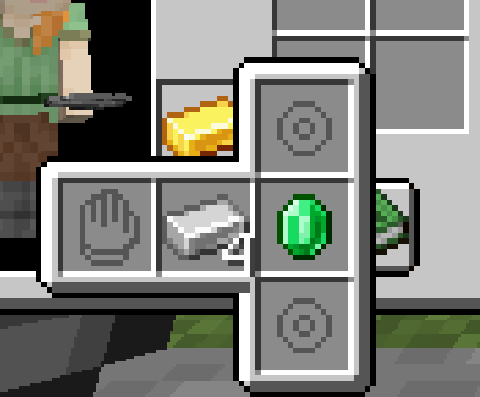
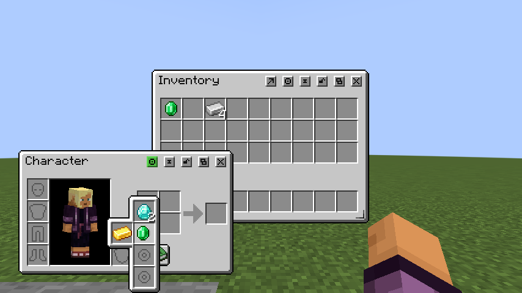
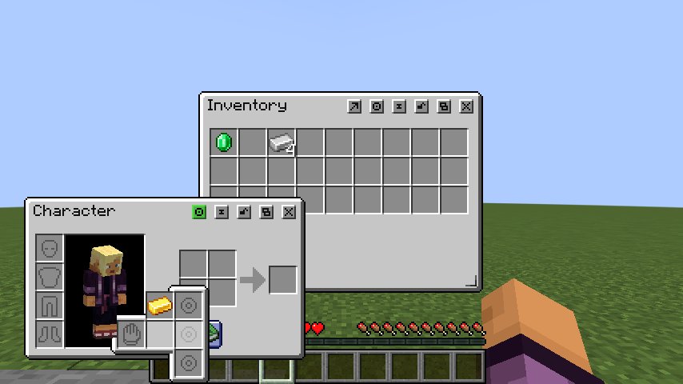
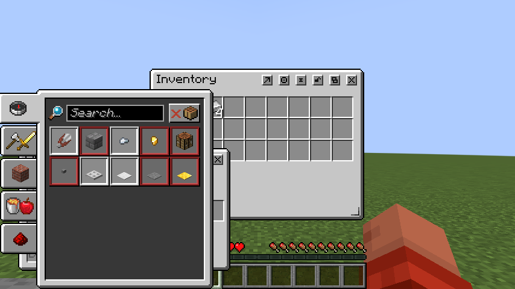
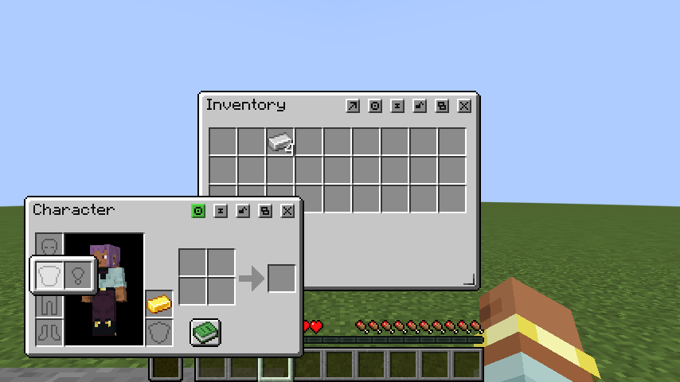
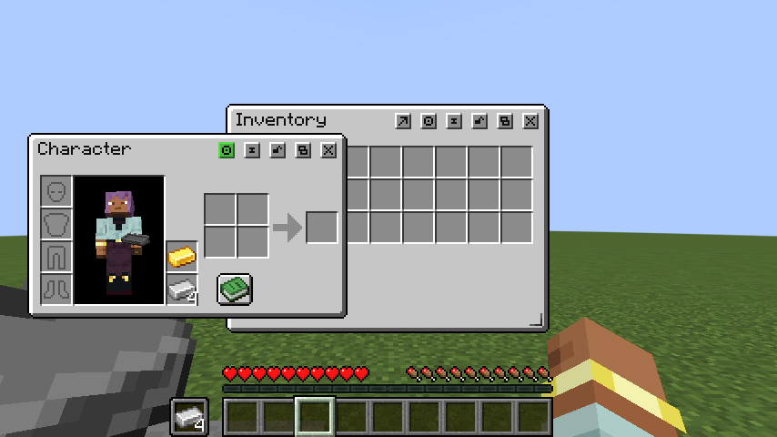
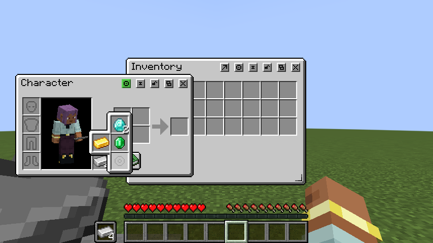

# Trinkets focused validation - Minecraft 1.21.1 Fabric

Test date: 2026-10-22. Target: Core 0.1.5 + Compatibility 0.1.2 + Trinkets 3.10.0.

This is focused coverage of the new Character attachment and native player-menu integration,
not a complete functional or gameplay suite. No other release target gained this adapter.

## Build and isolation checks

- Both requested Fabric production JARs assembled successfully.
- Optional integration bootstrap tests: 3 tests, no failures, errors or skips.
- Shared 1.21.1 Core and Compatibility sources also compiled for NeoForge, ensuring the
  Fabric-only native adapter is excluded there. This does not add NeoForge Trinkets support.
- Source and production-JAR boundary scanner verified API-only extension imports, no
  third-party integration classes in Core, and no Core, Trinkets, CCA or QA classes bundled
  inside Compatibility. Fabric metadata pins Compatibility to Core 0.1.5.
- The release staging operation replaces only the two 1.21.1 Fabric artifacts and the same
  entries in the aggregate ZIP; it preserves the other 34 distribution JARs.

## Executed gameplay checks

Windows computer use controlled a real Minecraft client in an isolated disposable singleplayer
world. The opt-in QA mod supplied native Trinkets slot definitions and vanilla wearable test
items, allowing validation without relying on a separate accessory content mod. Server and
client snapshots recorded real menu contents and the shared cursor.

Gameplay used Loom's development runtime built from the changed sources. The remapped
production JARs received packaging and boundary checks; a separate installed-JAR gameplay
launch was not performed.

| Focused case | Observed result |
| --- | --- |
| Startup with Core, Compatibility and Trinkets | World loaded and both Inventory and Character opened. |
| Optional target absent | A separate profile with Core + Compatibility and no Trinkets/QA mod loaded the saved world and opened ordinary Inventory and Character. |
| Native horizontal group and vertical instances | Hand and ring panels expanded using native textures and hover state. |
| Native item tooltips | The native equippable-slot tooltip rendered. |
| Shared cursor | Pickup in Inventory, right placement into an accessory and further transfers used the same server-owned cursor. |
| Native equip/unequip/effect lifecycle | Native equip, unequip and tick callbacks executed on the integrated server. |
| Placement validation | Iron ingots were refused; the carried stack and accessory contents stayed correct. |
| Removal restriction | The removal-locked gold item resisted pickup, swap and quick extraction. |
| Multiple instances | Three native ring instances accepted the expected emerald/diamond stacks; snapshots matched. |
| Quick transfer transport | Ring-to-storage and storage-to-equipment requests completed; native quick-move predicates excluded the face slot. |
| Repeated menu rebuild | Three native rebuilds preserved two Core expanded slots, unique identities, slot indices and tracker lengths. |
| Runtime capacity change | A fourth ring slot materialized and shifted Core expanded slots correctly; both sides had 62 slots and matching keys. |
| Content sync while panel open | Selection remained on the logical group/type after native slot objects were rebuilt. |
| Save/rejoin | Native accessory contents and Core expanded slots survived client restarts. |
| Close/restore | Closing released native hover selections; reopening remained functional. |
| Four-slot popup near bottom | After the placement fix, all four instances and their frame fit on the small 856 x 512 test window. |
| Original hidden-offhand behavior (superseded) | The first pass validated a blank accessory anchor. The visual follow-up below replaces it with the real offhand slot. |
| Panel over recipe toggle | Clicking an offhand ring over the recipe button selected the native accessory, without opening the book. |
| Ordinary recipe toggle | With the panel dismissed, the Character recipe guide opened. |
| Recipe book covering accessories | The corrected book covered the accessory artwork; clicking a covered slot left native group/type selection empty and the cursor unchanged. |

Quick-transfer checks invoked the actual Core client-to-server transport through isolated QA
commands. They did not physically hold Shift and click. Ordinary pickup, right placement,
swaps, rejection and popup interactions were performed through the UI.

## Bugs corrected during these checks

- Native content synchronization recreated Slot objects and dismissed an open popup. The
  adapter now restores selection by native group/type identity.
- A capacity increase could put the fourth instance below the viewport. The generic built-in
  attachment API now allows placement reservations for expandable panels.
- Offhand-linked panels could share pixels with the recipe button. Attachment-owned pixels
  now take priority over the owner's base controls, while an open recipe book retains its own
  overlay priority.
- On a small viewport, an accessory item could draw through an overlapping recipe book.
  Built-in attachments now render below that book and stop exposing covered slot hits.

## Dedicated server

An isolated dedicated server with Core, Compatibility and Trinkets reached Minecraft's
`Done` state and shut down cleanly. It bound only to loopback and used a temporary port.
No player joined this dedicated server. Inventory gameplay used the integrated server.

## Visual/offhand follow-up - 2026-10-22

The original visual review missed the player model covering parts of the chest, belt and face
panels. This follow-up addresses those confirmed defects and replaces the blank offhand anchor.

- Core flushes the preview/control pass and starts a foreground stratum for each built-in
  attachment. Compatibility separates native panel backgrounds, slot backgrounds/icons and
  item/highlight passes. These contributions still render below later desktop windows and
  the open recipe guide.
- The reusable `requestsBuiltinSlot(45)` hook lets Compatibility keep Character's real offhand
  visible with Trinkets active. Core has no Trinkets mod check or native dependency.
- In-game inspection confirmed complete hat/face, necklace and belt frames in front of the
  player preview, plus correct ring-panel items, highlights and tooltips.
- With Return Hotbar to Inventory OFF, four iron ingots placed into Character's offhand also
  appeared in the HUD offhand. HUD pickup emptied Character's view and produced one cursor
  stack of four. Character placement restored both views. A right-click split in Character and
  merge through the HUD ended with exactly four in native slot 45 and an empty cursor.
- Turning Return Hotbar to Inventory ON moved the hotbar into Inventory and retained the
  same four ingots in Character's offhand; the former HUD offhand was hidden as expected.
- A foreground Inventory window covered the Character model and accessory items. The
  recipe guide also covered accessory artwork when viewport constraints forced it over
  Character; a covered click left native group/type selection empty and the cursor unchanged.
- Both Fabric production JARs assembled and the source/JAR boundary scanner passed again.
  Only the same two target JARs and aggregate ZIP entries were replaced.

Follow-up evidence: `output/screenshots/trinkets-1.21.1-fabric/fixes/`,
`build/trinkets-layer-offhand-gameplay.log`, `build/trinkets-visual-fix-build.log` and
`build/trinkets-layer-offhand-boundaries.log`. This remained a focused development-runtime
check; the full suite, remote multiplayer and combined controller/Spatial UI paths were not run.

The [visual-fixes PDF](../output/pdf/trinkets-1.21.1-fabric-visual-fixes.pdf) shows before/after
panel crops, the same offhand stack in both views, and foreground-window/recipe-guide coverage.

## Evidence and reproduction

### Exact offhand-popup overlap follow-up

The earlier foreground fix did not preserve native ordering between inactive accessory slots
and the active popup. Compatibility now renders inactive backgrounds/items first, followed by
the active frame, active slot backgrounds/icons, active items and native anchor. Hit testing
also ignores inactive groups while the native active group owns the popup.

The focused development-runtime check explicitly opened **group `offhand`, type `ring`**,
with the neighboring gold slot present. The complete popup outline rendered above that slot.
Clicking the overlapping edge retained `offhand` / `ring` and an empty cursor. The client
snapshot is `build/trinkets-popup-order-client-state.json`; logs are
`build/trinkets-popup-order-gameplay.log` and `build/trinkets-popup-order-build.log`.
Compatibility assembled and the source/production-JAR boundary scanner passed. Core's JAR
was unchanged by this final ordering fix. No full suite ran.

- Fixture: `functional-tests/trinkets-1.21.1-fabric/`.
- Client launcher: `functional-tests/trinkets-qa.init.gradle`.
- Dedicated launcher: `functional-tests/trinkets-server-smoke.init.gradle`.
- Logs and snapshots: `build/trinkets-gameplay-r*.log`, `build/trinkets-qa/`,
  `build/trinkets-dedicated-final.log`, `build/trinkets-absent-startup.log`.
- Production packaging manifest: `build/trinkets-release-artifacts.json`.
- Screenshots: `output/screenshots/trinkets-1.21.1-fabric/`.

### Initial evidence (before the visual/offhand follow-up)

### Updated visual/offhand evidence

The fixture is development-only and is never packaged in a production mod. See the
[integration documentation](../docs/markdown/trinkets-1.21.1-fabric.md) for its launch command.

## Coverage limits

No full gameplay suite ran. This does not certify every accessory content mod, extreme
datapack slot counts, every GUI scale, multiplayer latency/races, dedicated-server inventory
sessions, creative-mode interactions, physical Shift-click combinations, or combined
Controlify/Spatial GUI behavior. Only the supported Trinkets 3.10.0 ABI is enabled; other
Trinkets versions and other Minecraft/loader targets remain outside this change.
